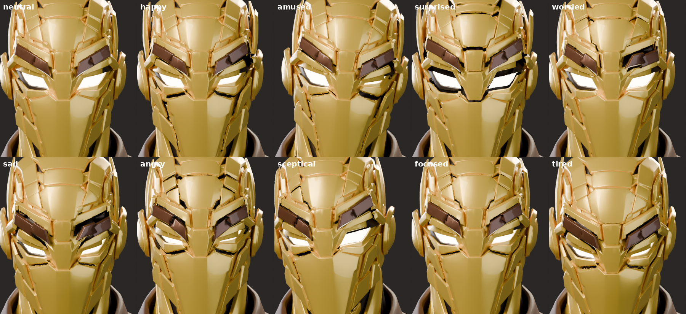

# Golden Sentinel – articulated mechanical robot head

The Meshy "Golden Sentinel" bust, rebuilt in Blender with **every armour plate as
an independent object**, organised into functional mechanical groups and driven
by high-level expression controls (`CTRL_FACE`). It is designed to be driven
live by the webcam face tracker (MediaPipe → UDP 127.0.0.1:8765).



## How it works

1. **Segmentation** (`pipeline/`): the fused Meshy mesh (562k verts / 1.12M tris)
   is split along its concave plate creases. This uses dihedral concavity,
   distance-to-crease markers, a watershed flood and a region-adjacency merge,
   and gives about 400 regions (one per plate).
   The geometry is never modified, only partitioned.
2. **Mechanical design** (`design/face_design.json`): plates are assigned to
   about 45 functional groups. These are brows (inner/outer, dark bronze),
   upper/lower lids, eye lights, cheeks, forehead tiers and transitions,
   temples, fins, ear discs, nose bridge, mask and chin. Each group has a pivot
   and a local frame (X lateral, Y up the surface, Z out of the plate).
   Expression controls are authored for the left side and mirrored to the right
   automatically. Each control moves several groups, with staged delays for the
   live runtime.
3. **Build data** (`data/`): `face_labels.u16.xz` (a region id per OBJ face),
   `regions.json` (per-plate name/group/class/pivot), `rig.json` (groups,
   controls, expressions, head/neck) and `core.npz.xz` (the dark inner core
   seen when plates lift).
4. **Blender build** (`blender/build_robot_head.py`): parses your local Meshy
   OBJ and creates one object per plate with Meshy's original per-corner
   normals and a solidified dark backing. It builds the empty hierarchy
   `RIG_ROOT > NECK > HEAD_ROOT > GRP_<group>.rest > GRP_<group> > plates`,
   plus `CTRL_FACE` with every control as a custom property. Drivers on each
   `GRP_*` node compute `clamp(sum(gain * control))`.

## Build it in Blender (4.2+ / 5.x)

```python
import runpy
runpy.run_path(r"C:\path\to\Robot-head\blender\build_robot_head.py", init_globals={
    "OBJ_PATH": r"C:\path\to\Meshy_AI_Golden_Sentinel_1006194324_generate.obj",
    "DATA_DIR": r"C:\path\to\Robot-head\data",
})
```

The OBJ itself is not in this repo. The build checks a checksum so the labels
are only applied to the exact Meshy file.

## Controls (`CTRL_FACE` custom properties)

`brow_{l,r}_raise`, `brow_{l,r}_lower`, `brow_{l,r}_inner`,
`eye_{l,r}_open` (neutral 0.75), `eye_{l,r}_squint`, `cheek_{l,r}_raise`,
`forehead_center_raise`, `forehead_{l,r}_tension`, `temple_{l,r}_flare`,
`face_{l,r}_tension`, `jaw_open`, `smile`, `surprise`, `concern`,
`head_yaw`, `head_pitch`, `head_roll` (radians).

Expression presets (`rig.json → expressions`): neutral, happy, amused,
surprised, worried, sad, angry, sceptical, focused, tired. The build keys them
as a timeline reel (markers name each pose).

## Status

- [x] plate segmentation v2 (auto) – zone audit in progress
- [x] functional groups, controls, mirrored effects, drivers, expression reel
- [ ] expression tuning to pass the "identifiable without labels" gate
- [ ] Blender live UDP receiver + control panel
- [ ] GLB runtime export (one node per group) + Godot evaluator
- [ ] hook into the existing tracker / Godot avatar project
